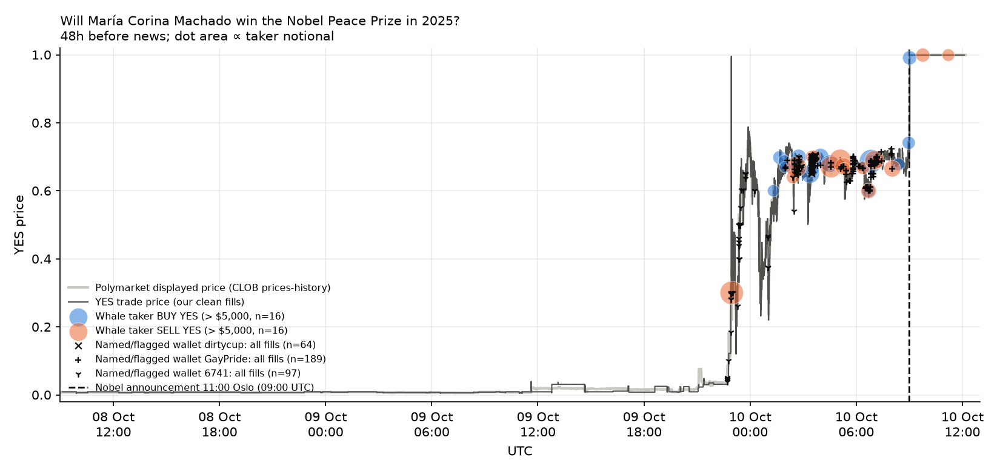

# Wallet Behaviour and Information Flow on Polymarket

Group project for FN6908 Trading Analytics & Processes, MSc in Financial Engineering, Nanyang Technological University (2026).

Do traders on a public prediction market act before the news? This project uses trade-level Polymarket data, where every fill carries the wallet address, to ask:

1. Are large traders followed by other traders?
2. How do prices respond to their trades?
3. Do the followers get worse prices?
4. When a wallet appears to trade on private information, who pays for it?

It compares events where suspected informed trading was reported (Nobel Peace Prize 2025, the January 2026 Maduro raid, NFL MVP 2024-25, the February 2026 US strike on Iran) with control events where the result was not known in advance (FOMC decisions, Ballon d'Or 2025, the June 2025 Iran strikes).



## Key results

**Data.** 26 markets, 618,681 cleaned fills and 2,448 wallet profiles, all from public Polymarket APIs. Checks: 260 of 260 sampled fills matched on-chain (Polygon), volumes are within 1.5% of Polymarket's own figures, and prices are within about 1¢.

**Prices drift before the news in leak events, not in controls (A1).** Drift towards the outcome in the 24 hours before the news, with p-values from 200 placebo windows in the same market:

| Event | Drift | p | Share of the move priced before the news |
|---|---|---|---|
| Nobel Peace Prize 2025 | +68.4pp | 0.005 | 69% |
| NFL MVP 2024-25 | +50.0pp | 0.005 | 89% |
| US strike on Iran, Feb 2026 | +19.5pp | 0.005 | 20% |
| Maduro out by 31 Jan 2026 | +5.0pp | 0.015 | 4% |
| Controls: FOMC Jul / Sep 2026, Ballon d'Or 2025 | +1.8 / +1.0 / −22.4pp | 0.24 / 0.52 / 1.0 | |

**Standard toxicity measures don't separate leaks from anticipation (A2).** VPIN is high before Nobel and Maduro, but also before scheduled control events and for near-certain favourites. Kyle's λ is never higher before the news.

**A simple wallet rule separates them (A3).** The rule flags wallets that are new, trade few events, buy one side at long odds and buy late. It flags 15–25% of pre-news buyers in leak events, but 1 of 464 and 0 of 446 in the FOMC markets and 0 of 86 in Ballon d'Or 2025. Across the leak events, 31 suspected informed wallets made about $942k.

**Large traders are followed, suspected informed wallets are not (A4).** Each large trade is matched to an ordinary trade with similar size, price and prior activity:
- Large trades draw +1.35 extra same-direction orders within 5 minutes (1,405 pairs, 24 markets, p < 0.001).
- Large trades move the price +0.22pp after 15 minutes, and followers pay +0.13pp more.
- Suspected informed wallets trade in small, spread-out orders and draw no extra followers (30 pairs, p = 0.71).

**Ordinary resting orders paid, not market makers (A5).** Two-sided market makers supplied only 3–31% of the $942k. Most came from one-sided limit orders and active traders, and the top 10 counterparties paid 61–87% per event.

**A real-time monitor works only for scheduled news (A6).** Replaying the A3 rule live, the final 24 hours before scheduled announcements produced 49 alerts in leak markets, 6 in controls and 0 for award favourites. It is an alarm, not a direction signal: 23 of the 49 pointed the right way. For unscheduled events it is too noisy (151 alerts in 7 days for Iran 2025).

**Open case: Ballon d'Or 2026.** Votes closed on 28 September and the ceremony was on 26 October, so the winner was fixed but secret in between. On 9 October Harry Kane's price rose from 56% to about 62% with no news found. A new wallet (0x3ed2c452…) then bought about $30k of Kane at an average of 65.7¢. It fits the rule only partly, because it bought after the move began.

Recommendations for market makers, large traders, platforms and regulators are in [`mitigation.md`](mitigation.md). The full data report and source log is [`feasibility.md`](feasibility.md).

## Methods

- **Data pipeline:**
  - Gamma API for market metadata; Data API for trades with wallets; CLOB price history.
  - Cleaning keeps one row per economic fill and expresses every trade as a YES trade.
  - Validation against on-chain `OrderFilled` events, decoding both CTF Exchange V1 and V2 layouts.
- **Event study:** price drift, order imbalance and volume before the news, tested against placebo windows in the same market.
- **Microstructure:** VPIN with equal-dollar volume buckets, and Kyle's λ from 15-minute regressions of the change in log-odds on net order flow.
- **Wallet forensics:** wallet age, breadth of activity, one-sidedness, entry price and timing.
- **Follower analysis:** event and control episodes matched on size, price and prior activity. Inference uses a market-clustered bootstrap and sign-flip tests.
- **Counterparty analysis:** maps each flagged wallet's profit to the wallets on the other side and classifies them by behaviour.

Python 3, pandas, NumPy, PyArrow, Matplotlib, Requests.

## Repository

| Path | Contents |
|---|---|
| `polymarket_feasibility.py` | Data pipeline: market identification, trade download, cleaning, validation, per-market charts |
| `analysis_a1.py` … `analysis_a6.py` | Modules A1–A6 as above |
| `markets.csv` | Market identifiers, news timestamps and sources |
| `data/raw/`, `data/clean/` | Cached API pulls and cleaned fills (parquet) |
| `data/validation/`, `data/analysis/` | Validation checks and module results (CSV) |
| `charts/` | Figures |

## Reproduce

```bash
python3 -m venv .venv
.venv/bin/python -m pip install -r requirements.txt
.venv/bin/python polymarket_feasibility.py   # uses cached data/raw; --refresh re-downloads
.venv/bin/python analysis_a1.py              # then analysis_a2.py … analysis_a6.py in order
```

All data come from public Polymarket APIs that need no key.

## Disclaimer

Wallets are pseudonymous, and the results show trading consistent with advance knowledge, not proof of insider trading. The only case with legal action is the Maduro raid: a US service member has been charged, not convicted, and the link to the wallet here rests on matching public facts in the indictment. This is academic research, not affiliated with Polymarket, and not investment advice.
